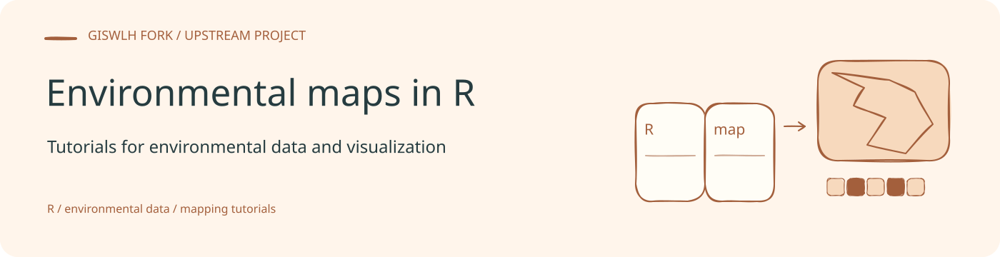
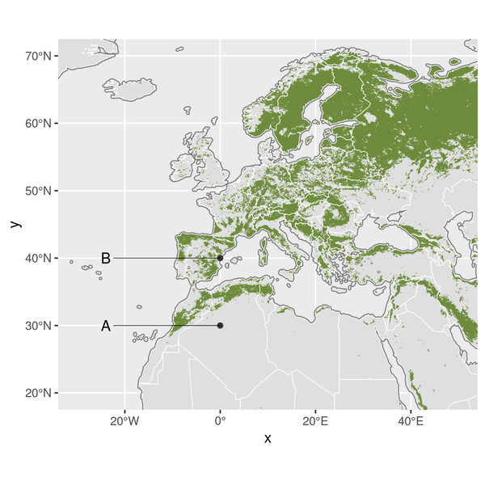

<!-- readme-visual-refresh:banner -->

<!-- /readme-visual-refresh:banner -->

# R tutorials in processing and visualization of environmental data 

This is a repository containing all tutorials as highlighted in our [blog](https://bluegreenlabs.org/categories/tutorial/). The code is well annotated but for more context we refer to our blog posts.

## How to cite these code snippets in your article

You can cite this code as "We used processing / vizualization as outlined in Hufkens & Kearsley (2022)". With the following bibliographic reference to include in your reference list:

> Hufkens, K. & E. Kearsley. BlueGreen Labs (2022). (Version v1.2.0). R tutorials in processing and visualization of environmental data. Zenodo. [http://doi.org/10.5281/zenodo.7004926](http://doi.org/10.5281/zenodo.7004926).

<!-- readme-visual-refresh:artwork-source -->
[Editable banner artwork · Excalidraw](assets/readme/banner.excalidraw)
<!-- /readme-visual-refresh:artwork-source -->

<!-- readme-visual-refresh:selected-result -->

## 已有结果展示

原 R 制图练习保存的欧洲及周边区域地图，展示绿色空间图层和位置标注。 该图为仓库已有上游示例，保留原有来源；本次仅整理展示，未重新运行。 [查看来源](https://github.com/GISWLH/R_maps/blob/master/map_building_1/output/05.png)。

<!-- /readme-visual-refresh:selected-result -->
